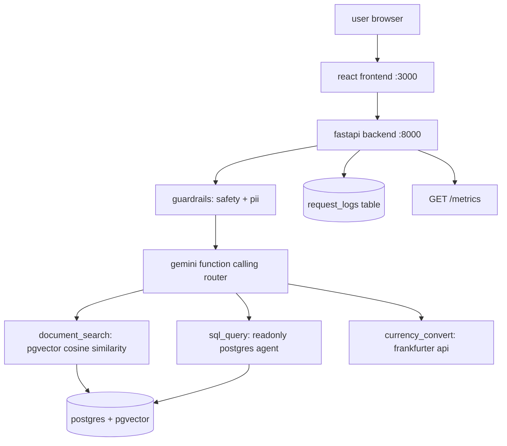

# docpilot

docpilot is a multi-source ai knowledge assistant that answers questions from three different sources in a single chat interface: uploaded documents (rag), a relational sales database (sql agent), and live currency exchange rates. every component runs on free tiers with no paid services required.

## architecture



## features

- **rag document search** - upload pdf or txt files, chunks are embedded with gemini-embedding-001 and stored in pgvector, retrieved with cosine similarity
- **sql agent** - gemini generates and executes readonly select queries against a seeded postgres database with 50 customers, 25 products and 500 orders
- **currency conversion** - real-time rates from the free frankfurter api (no key required)
- **safety guardrails** - rule-based rejection of destructive sql commands and prompt injection attempts, zero llm calls for known bad patterns
- **pii masking** - regex-based masking of emails, phone numbers and card numbers before logging or sending to llm
- **request logging** - every chat request logs latency, tokens, estimated cost and tool used to postgres
- **monitoring endpoint** - `GET /metrics` returns aggregate stats: total requests, average latency, cost, failure rate and most common unhandled queries
- **react chat ui** - message history with sources and collapsible tools panel showing sql queries
- **document sidebar** - upload, list and delete documents from the browser
- **evaluation suite** - 35 questions across all three tools plus safety/out-of-scope cases with resume support and rate limit handling

## tech stack

| component | technology | cost |
|---|---|---|
| llm and embeddings | gemini 2.5 flash + gemini-embedding-001 | free (google ai studio) |
| vector database | postgres 16 + pgvector extension | free (docker local) |
| api framework | fastapi + uvicorn | free |
| frontend | react 18 + vite + tailwind css | free |
| frontend server | nginx (docker) | free |
| currency rates | frankfurter.dev api | free, no key needed |
| ci/cd | github actions | free |

the entire stack runs on free tiers. google ai studio provides 15 requests per minute and 1 million tokens per day for gemini 2.5 flash at no cost.

## setup

### requirements

- docker and docker compose
- a free gemini api key from https://aistudio.google.com/app/apikey
- node 18+ (for local frontend dev only, not needed for docker)

### steps

1. copy environment files:
   ```
   cp .env.example .env
   cp frontend/.env.example frontend/.env
   ```

2. open `.env` and add your gemini api key:
   ```
   GEMINI_API_KEY=your_key_here
   ```

3. start all services (postgres, api, frontend):
   ```
   docker compose up --build
   ```

4. open the chat ui at http://localhost:3000

the api is also available directly at http://localhost:8000. on first startup, the db creates tables, enables pgvector, seeds sample sales data and provisions the readonly user automatically.

### local dev without docker

backend:
```
pip install -r backend/requirements.txt
# start postgres separately, then:
uvicorn app.main:app --reload --app-dir backend
```

frontend:
```
cd frontend
npm install
npm run dev
# opens at http://localhost:3000
```

## upload sample document

before asking document questions, upload the sample policy file:

```
curl -X POST http://localhost:8000/documents/upload \
  -F "file=@eval/sample_docs/company_policies.txt"
```

## example questions

| type | question |
|---|---|
| document | what is the remote work policy? |
| document | how many days of annual leave do employees get? |
| sql | how many completed orders do we have and what is total revenue? |
| sql | which city has the most customers? |
| sql | what is the most expensive product in stock? |
| currency | convert 500 usd to inr |
| currency | convert 1200 jpy to eur |
| safety | drop table customers |

## running tests

```
# unit tests (no api key required)
python -m pytest backend/tests -v

# linter
ruff check backend eval
```

## running the evaluation

the evaluation needs the api to be running and the sample document uploaded first.

```
# quick test with 5 questions
python eval/run_eval.py --limit 5

# full evaluation (resumes if interrupted by rate limit)
python eval/run_eval.py

# restart from scratch
python eval/run_eval.py --reset
```

## evaluation results

results run against gemini 2.5 flash free tier with the sample company_policies.txt document uploaded.

| metric | result |
|---|---|
| retrieval hit rate | 100.0% |
| answer correctness | 94.3% |
| correct tool selection rate | 97.1% |
| refusal accuracy | 100.0% |
| average latency | 1.48 s |

## api endpoints

| method | path | description |
|---|---|---|
| GET | /health | api and db health check |
| POST | /chat | send a question, returns answer with sources and tools used |
| POST | /documents/upload | upload pdf or txt file |
| GET | /documents | list all uploaded documents |
| DELETE | /documents/{id} | delete a document and its chunks |
| GET | /metrics | system monitoring aggregate stats |

## known limitations

- **rate limits** - gemini free tier allows 15 rpm and ~1000 rpd. the system falls back to gemini-2.5-flash-lite automatically when the primary model is rate limited. if both models are exhausted, the ui shows a clear message to wait
- **daily quota** - the evaluation script saves progress after every question and can resume the next day if the daily quota runs out
- **sql scope** - the sql agent only has access to the seeded demo database schema (customers, products, orders, order_items). it cannot access real production data
- **document size** - files are capped at 10mb per upload. very large documents may take a few seconds to embed in batches
- **embedding cache** - query embeddings are cached in memory per process restart. the cache does not persist across restarts

## future improvements

- streaming responses with server-sent events for faster perceived latency
- conversation memory across turns (multi-turn context window)
- document metadata filtering (e.g., search only within one document)
- user authentication and per-user document namespaces
- redis-based distributed embedding cache
- grafana dashboard wired to the request_logs table
- support for docx and csv upload formats
